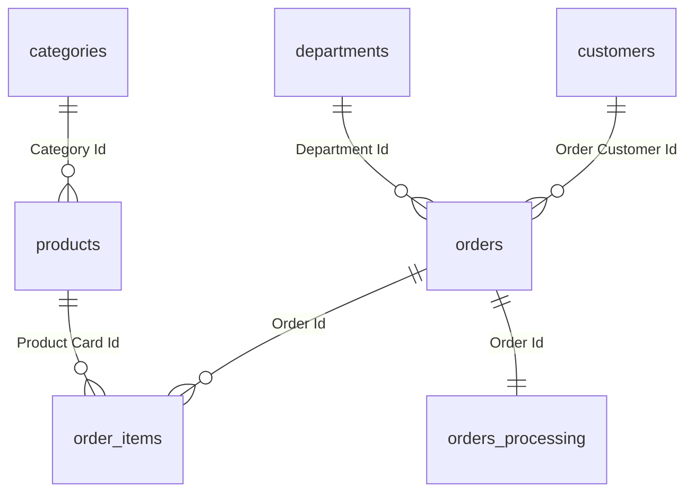
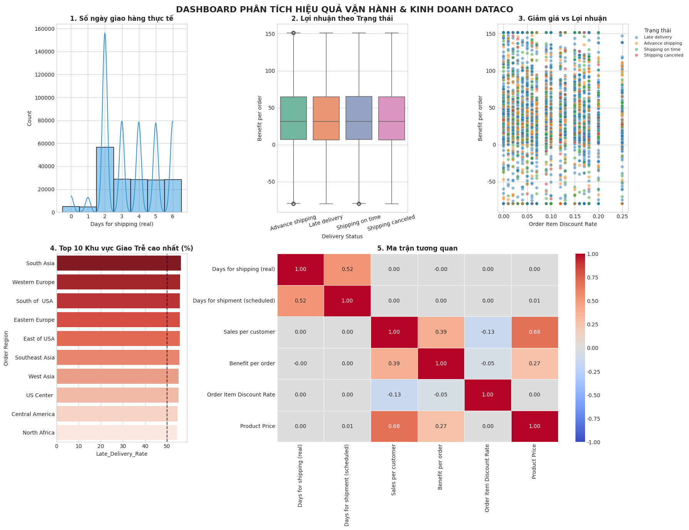
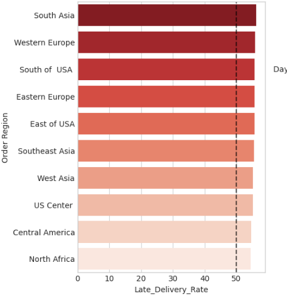

# DataCo Smart Supply Chain Analysis

Exploratory analysis of an e-commerce / retail supply-chain dataset (DataCo Global, Jan 2015 – Jan 2018): data cleaning and KPIs in Python, RFM customer segmentation, and a 3-page Power BI dashboard on sales, delivery performance and customer segments.

> Course project (Module 03). **My role:** _[fill in]_

## Dataset

Constante, F., Silva, F., Pereira, A. (2019). *DataCo SMART SUPPLY CHAIN FOR BIG DATA ANALYSIS*. Mendeley Data, V5. doi:[10.17632/8gx2fvg2k6.5](https://data.mendeley.com/datasets/8gx2fvg2k6/5) · licence CC BY 4.0 · [Kaggle mirror](https://www.kaggle.com/datasets/shashwatwork/dataco-smart-supply-chain-for-big-data-analysis).

180,519 rows × 53 columns. **Each row is an order item**: there are 65,752 distinct orders, 20,652 customers, 118 products in ~50 categories. Orders run from 2015-01-01 to 2018-01-31 (2018 is one month only). The raw CSV is not committed; see `data/README.md`.

## Business questions

1. What does the sales picture look like (revenue, profit, markets, categories, customer segments)?
2. How reliable is delivery, and where do delays come from?
3. Does discounting erode profit?
4. Which customers are most valuable, and which are slipping away?
5. Which operational fixes does the data support?

## Repository structure

```
├── data/README.md                          # download instructions, data dictionary
├── notebooks/01_dataco_eda_rfm.ipynb       # cleaning, KPIs, RFM, charts, Excel export
├── powerbi/dataco_supply_chain_dashboard.pbix
├── reports/
│   ├── DataCo_Python_Analysis_Report_VI.docx   # written report (Vietnamese)
│   ├── DataCo_PowerBI_Insights_VI.pptx         # dashboard insights (Vietnamese)
│   └── figures/
└── docs/verification_notes.md              # claims in the reports checked against the data
```

## Method

**Python (`01_dataco_eda_rfm.ipynb`)**
- Dropped PII/empty columns (email, password, names, image, description, zipcode), parsed dates, filled missing customer state, confirmed 0 duplicate rows.
- Winsorised `Sales per customer` and `Benefit per order` with the 1.5×IQR rule (1,943 and 18,942 rows clipped to [−110.15, 461.93] and [−79.70, 151.50]).
- Descriptive statistics with coefficient of variation, delay days, profit margin, KPIs by region and payment type, correlation heatmap.
- RFM: quartile scores (R, F, M), five segments, revenue share per segment.

**Power BI (`dataco_supply_chain_dashboard.pbix`)** – 3 pages: *Sale Report*, *Delivery Report*, *Customer Segment* (plus a tooltip page). Seven-table model with six DAX measures (`TotalSales`, `AOV`, `% DIFOT`, `Late Delivery Rate`, `Avg Profit/Cus`, `Avg Sales per Customer`).





## Key findings

| Topic | Finding |
|---|---|
| Size | $36.8M list-price sales ($33.0M after discounts) and $3.97M profit, a stable ~12% margin (11.4–12.3% each year). |
| Customers | Consumer 51.8%, Corporate 30.2%, Home Office 18.0% of customers; revenue and profit split in the same proportions. |
| Late delivery | **54.8%** of order items (98,977) are late; **57.3%** of non-cancelled orders (36,048 of 62,897) in the Power BI measure. |
| Not geographic | Late rate is 52.8–58.0% in 22 of 23 regions (only Canada is lower, 48.8%) and 54.4–55.2% in every market. There are no regional hotspots. |
| Shipping mode | First Class is late **95.3%** of the time (scheduled 1 day, actual 2), Second Class **76.7%** (2 vs 4), Standard Class **38.1%** (4 vs 4), Same Day 46.1%. Standard Class still produces the most late orders (41.6%) because it is 60% of volume. |
| Discounts | Weak linear effect: r = −0.05 between discount rate and profit (heatmap, after clipping). Average profit per item falls from $23.9 (0–5% discount) to $18.4 (>20%). About 18.7% of items lose money in every discount band, with no jump at 15%. |
| Delivery vs profit | Average profit per item is $21.62 for late items vs $22.40 for others, a small gap. |
| Payment risk | All 4,062 `SUSPECTED_FRAUD` items are paid by `TRANSFER`. 15.5% of TRANSFER items are cancelled (7.4% cancelled + 8.1% suspected fraud) and no other payment type has any. |
| RFM | 4,103 "At Risk" customers (19.9%, avg recency 470 days) hold **30.2%** of revenue; "Needs Attention" 5,132 (43.4%), "Champions" 1,833 (18.0%), "Potential Loyalists" 8,529 (6.2%), "Lost" 1,055 (2.2%). |



## Recommendations supported by the data

- **Recalibrate shipping promises** for First and Second Class: the promised 1–2 days are not met. A what-if that sets scheduled days to 4 (non-Same-Day modes) lowers the late rate from 57% to about 34%, and to 5 days about 18% (see `docs/verification_notes.md`).
- **Pre-screen TRANSFER payments** before releasing stock: they are the only source of suspected-fraud and cancelled orders.
- **Re-engage "At Risk" customers**: they are one in five customers but 30% of revenue.
- **Review discount policy** with margin in mind (avg profit per item drops ~$5.5 from the lowest to the highest discount band) rather than assuming a 15% cliff.

## Limitations

- The dataset looks synthetic: actual shipping days are uniformly spread (2–6 days) for Standard and Second Class and fixed at 2 days for First Class, so findings describe this dataset, not real-world logistics.
- Winsorising profit hides large losses (raw minimum is −$4,275; 10.5% of rows were clipped).
- In the notebook `Total_Orders` counts order items, not orders; `% DIFOT` in Power BI includes cancelled orders in the denominator while `Late Delivery Rate` excludes them, so the two do not sum to 100%.
- "TotalSales" in Power BI is list price × quantity, while `AOV` uses sales after discount.
- The written reports contain several statements that this data does not support; see `docs/verification_notes.md` before quoting them.

## How to run

```bash
pip install -r requirements.txt
# download DataCoSupplyChainDataset.csv into data/ (see data/README.md)
jupyter notebook notebooks/01_dataco_eda_rfm.ipynb
```
Open the `.pbix` in Power BI Desktop (data is embedded).
